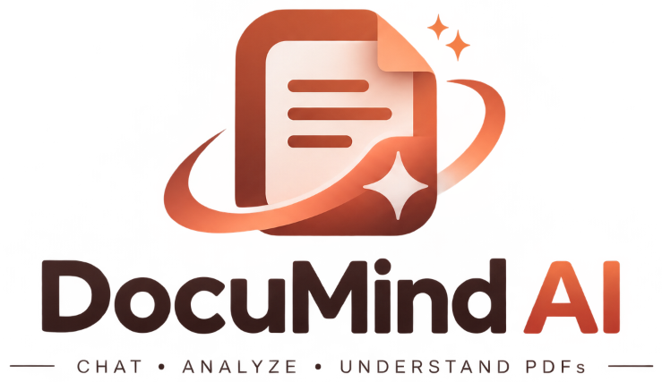
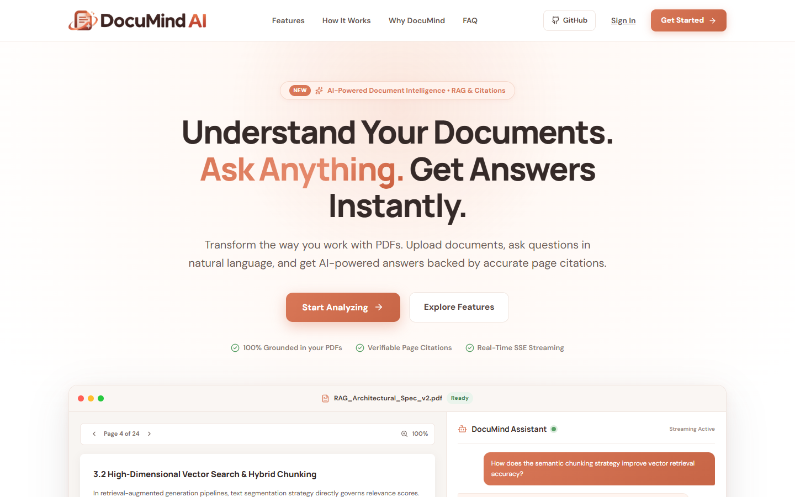
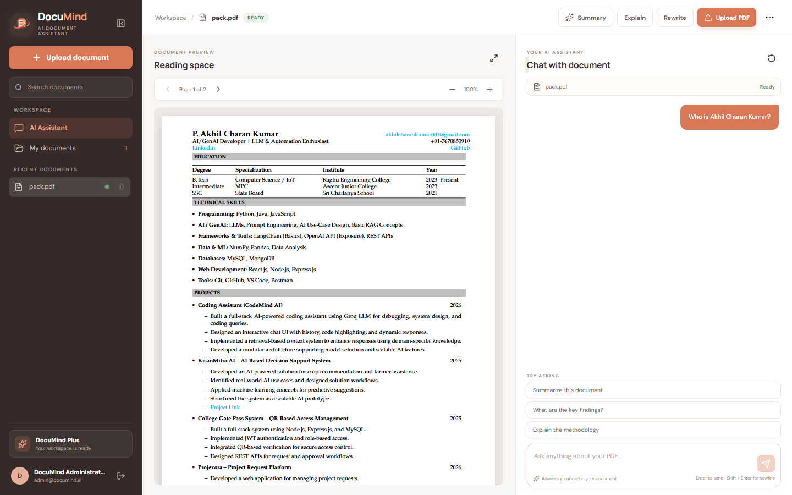
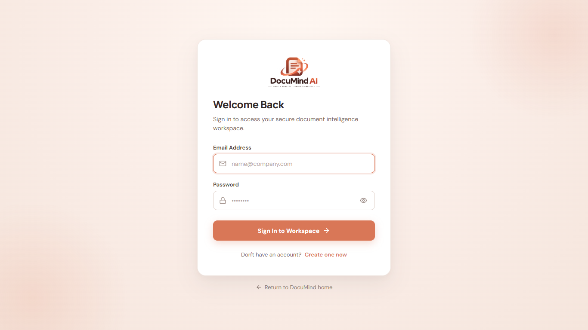
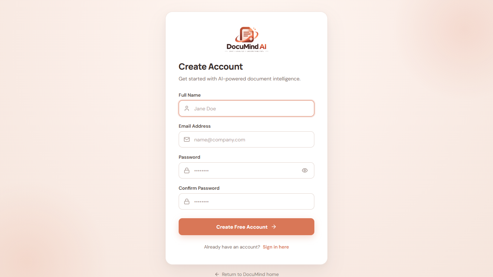
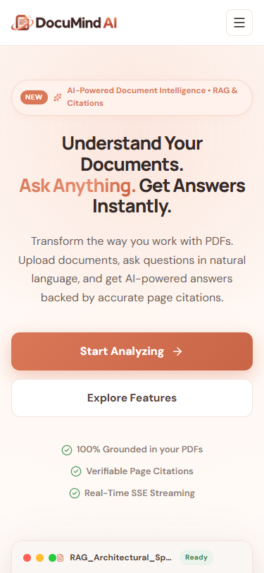
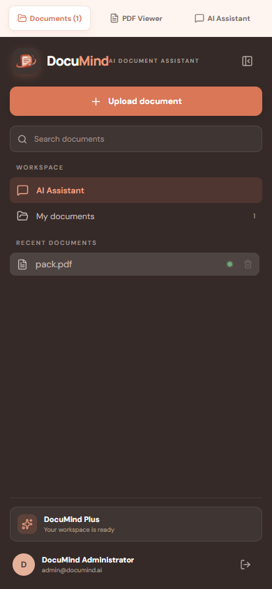

<div align="center">

  

  # DocuMind AI
  ### Enterprise AI-Powered PDF Document Intelligence & Conversational RAG Platform

  [](https://dotnet.microsoft.com/)
  [](https://react.dev/)
  [](https://azure.microsoft.com/services/cognitive-services/openai-service/)
  [](https://qdrant.tech/)
  [](https://www.mysql.com/)
  [](https://www.docker.com/)
  [](LICENSE)

  <p align="center">
    <strong>Transform complex PDFs into conversational intelligence.</strong><br />
    Ask questions in natural language and receive grounded answers backed by interactive, verifiable page citations.
  </p>

  <p align="center">
    <a href="#-key-features">Key Features</a> •
    <a href="#-system-architecture">Architecture</a> •
    <a href="#-visual-showcase">Screenshots</a> •
    <a href="#-tech-stack">Tech Stack</a> •
    <a href="#-quick-start-with-docker">Quick Start</a> •
    <a href="#-local-development">Development</a> •
    <a href="#-author--contact">Author</a>
  </p>

</div>

---

## 📸 Visual Showcase

### 1. Modern Marketing Landing Page
> Clean, responsive Sunset Coral theme showcasing features, architectural walkthrough, and interactive feature previews.

<div align="center">
  
</div>

---

### 2. ChatGPT-Style 3-Panel Workspace
> Independent scrolling across Sidebar, PDF Viewer, and AI Assistant with click-to-page citation navigation.

<div align="center">
  
</div>

---

### 3. Enterprise Authentication
> Secure Argon2id password hashing and JWT authentication with automatic silent refresh-token rotation in HTTP-only cookies.

| Sign In to Workspace | Create Free Account |
| :---: | :---: |
|  |  |

---

### 4. Full Mobile & Tablet Responsiveness
> Zero horizontal scrolling, touch-optimized typography, and a dedicated 3-panel mobile workspace switcher (`Documents (N)` | `PDF Viewer` | `AI Assistant`).

| Mobile Landing Page (375px) | Mobile Documents Workspace (390px) |
| :---: | :---: |
|  |  |

---

## ⚡ Key Features

- **🎯 Verifiable Page Citations**: Every claim made by the assistant includes interactive page chips with relevance confidence percentages. Clicking any citation chip instantly scrolls the PDF reader to that exact page and highlights the source context.
- **⚡ Real-Time SSE Token Streaming**: Experience instant token-by-token generation with Server-Sent Events (SSE) connected directly to Azure OpenAI `gpt-4.1-mini`.
- **📂 Independent 3-Panel Scrolling**: Built with a strict zero-body-scroll viewport design. The Recent Documents list, PDF reader canvas, and Chat message feed each scroll independently without page jumps.
- **🔐 Enterprise Multi-User Authentication**:
  - Passwords hashed using memory-hard **Argon2id** (3 iterations, 64 MB memory limit).
  - Short-lived 15-minute JWT Access Tokens paired with rotating 7-day Refresh Tokens stored in secure HTTP-only cookies.
  - Multi-user isolation ensures users can only query, read, or delete documents and vector embeddings they own.
- **⚙️ Automated Ingestion Pipeline**:
  - Clean text extraction with positional tracking using **PdfPig**.
  - Sliding-window text chunker with 1000-character target size and 200-character overlap.
  - 1536-dimensional embeddings generated with Azure OpenAI `text-embedding-3-small`.
  - Stored in **Qdrant Vector Database** with cosine distance index and document/user payload filtering.
- **🛡️ Resilient Error Handling**:
  - Automatic quota management and user-friendly status banners for Azure OpenAI HTTP 429 rate limits.
  - PDF signature verification (validates `%PDF` magic bytes) and 20 MB file size guards.
- **📱 Responsive Across All Devices**: Tested and verified across 11 screen sizes (320px mobile to 1920px desktop).

---

## 🏗 System Architecture

DocuMind AI follows **Clean Architecture** and **Domain-Driven Design (DDD)** principles to separate business logic from external frameworks:

```
                               ┌────────────────────────────────────────────────────────┐
                               │           React 19 + Vite Frontend (Nginx :80)          │
                               │  - SPA Router & Lazy Loading                           │
                               │  - PDF Viewer Canvas (react-pdf)                       │
                               │  - SSE Unbuffered Reverse Proxy                        │
                               └───────────────────────────┬────────────────────────────┘
                                                           │ HTTP REST / SSE Stream
                                                           ▼
                               ┌────────────────────────────────────────────────────────┐
                               │          ASP.NET Core .NET 10 Web API (:5000)          │
                               │  - Controllers & Rate Limiting                         │
                               │  - JWT Bearer Authentication                           │
                               │  - Serilog Structured Logging                          │
                               └───────────┬────────────────────────────────┬───────────┘
                                           │                                │
                                           ▼                                ▼
                     ┌───────────────────────────────────┐    ┌───────────────────────────────────┐
                     │       DocuMind.Application       │    │      DocuMind.Infrastructure      │
                     │  - Use Cases & CQRS Handlers      │    │  - Pomelo MySQL EF Core           │
                     │  - Service Interfaces & DTOs      │    │  - Qdrant Vector Client           │
                     │  - Domain Event Abstractions      │    │  - Azure OpenAI Client SDK        │
                     └─────────────────┬─────────────────┘    │  - PdfPig Document Parser         │
                                       │                      │  - Argon2id Password Hasher       │
                                       │                      └─────────────────┬─────────────────┘
                                       ▼                                        ▼
                               ┌────────────────────────────────────────────────────────┐
                               │                    DocuMind.Domain                     │
                               │  - Core Entities: User, Document, DocumentChunk        │
                               │  - Conversation & Message Aggregates                   │
                               │  - Domain Exceptions & Enums                           │
                               └────────────────────────────────────────────────────────┘
```

---

## 🛠 Tech Stack

| Layer | Technologies |
| :--- | :--- |
| **Frontend** | React 19, Vite, React Router v7, PDF.js (`react-pdf`), Lucide React, CSS Variables (Sunset Coral Design Tokens) |
| **Backend API** | .NET 10, ASP.NET Core Web API, Clean Architecture, Entity Framework Core 10, Serilog |
| **Relational Database** | MySQL 8.0 (Pomelo EF Core Provider) with automated migrations |
| **Vector Engine** | Qdrant Vector Database (v1.12+) via gRPC (:6334) & REST (:6333) |
| **Artificial Intelligence** | Azure AI Foundry: `gpt-4.1-mini` (Chat) & `text-embedding-3-small` (1536-dimensional embeddings) |
| **Security** | Argon2id password hashing, JWT Bearer tokens, HTTP-only refresh cookies, rate limiting |
| **Infrastructure** | Docker, Docker Compose, Nginx Alpine Reverse Proxy with gzip and SSE tuning |

---

## 🚀 Quick Start with Docker

The fastest way to launch the complete multi-container stack (MySQL, Qdrant, Backend API, and Frontend):

### 1. Clone the Repository
```bash
git clone https://github.com/Akhilcharankumarpujari/DocuMind.git
cd DocuMind
```

### 2. Configure Environment Variables
Copy the example environment file:
```bash
cp .env.example .env
```
Open `.env` and fill in your Azure AI Foundry credentials:
```ini
AZURE_OPENAI_ENDPOINT=https://YOUR_RESOURCE.openai.azure.com/
AZURE_OPENAI_API_KEY=YOUR_AZURE_OPENAI_API_KEY
AZURE_OPENAI_CHAT_DEPLOYMENT=gpt-4.1-mini
AZURE_OPENAI_EMBEDDING_DEPLOYMENT=text-embedding-3-small

MYSQL_ROOT_PASSWORD=YourSecureRootPassword123!
MYSQL_PASSWORD=YourSecureUserPassword123!
JWT_SECRET=YourSuperSecretKeyAtLeast32CharactersLong!
```

### 3. Launch with Docker Compose
```bash
docker compose up --build -d
```

### 4. Access the Platform
- **DocuMind Web Application**: [http://localhost](http://localhost) (or port `80`)
- **Backend Health Check**: [http://localhost:5000/health](http://localhost:5000/health)
- **Swagger OpenAPI Documentation**: [http://localhost:5000/swagger](http://localhost:5000/swagger)
- **Qdrant Vector DB Console**: [http://localhost:6333/dashboard](http://localhost:6333/dashboard)

---

## 💻 Local Development

If you prefer running services individually for development:

### Backend (.NET 10)
```bash
# 1. Start MySQL and Qdrant in Docker
docker compose up -d mysql qdrant

# 2. Run EF Core migrations & start the API
cd backend/src/DocuMind.WebApi
dotnet run --launch-profile http
```
The Web API will listen on `http://localhost:5000`.

### Frontend (React 19 + Vite)
```bash
cd frontend
npm install
npm run dev
```
The Vite dev server will start on `http://localhost:5173` with automatic API proxying to `http://localhost:5000`.

---

## 🧪 Automated Testing

DocuMind includes a comprehensive test suite covering domain entities, password hashing, JWT rotation, multi-user authorization, document processing, and RAG retrieval:

```bash
cd backend
dotnet test DocuMind.sln --logger "console;verbosity=normal"
```

---

## ☁️ Cloud Deployment Roadmap (Microsoft Azure)

DocuMind has completed its **Phase 8.1 Azure Cloud Deployment Readiness Audit** (Readiness Score: **82/100**).
The recommended production architecture targets:
- **Application Containers**: Azure Container Apps (utilizing 180,000 vCPU-seconds free per month).
- **Relational Store**: Azure Database for MySQL Flexible Server (Burstable B1ms free tier).
- **Document Storage**: Azure Blob Storage (Hot Tier, private container with backend-proxied streaming).
- **Vector Database**: Qdrant Cloud Free Tier (1GB managed cluster).
- **Secrets**: Azure Key Vault with User-Assigned Managed Identity.

---

## 👨‍💻 Author & Contact

**P. Akhil Charan Kumar**  
AI/GenAI Developer | LLM & Automation Enthusiast  
- **GitHub**: [@Akhilcharankumarpujari](https://github.com/Akhilcharankumarpujari)  
- **Email**: [akhilcharankumar001@gmail.com](mailto:akhilcharankumar001@gmail.com)  
- **LinkedIn**: [P. Akhil Charan Kumar](https://linkedin.com/in/akhilcharankumar)  

---

<div align="center">
  <sub>Built with precision and care for high-reliability PDF comprehension. © 2026 DocuMind AI.</sub>
</div>
